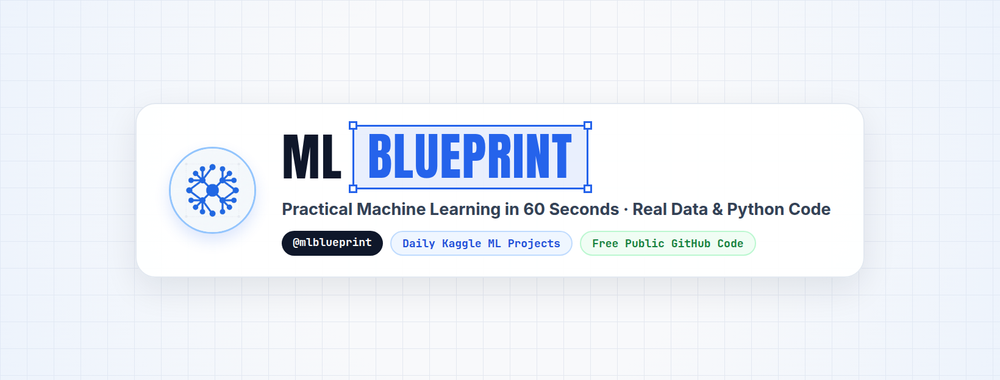

<p align="center">
  
</p>

# MLBlueprint (`@mlblueprint`) — Daily Practical Machine Learning Projects

> *Every node starts from real data and branches into a clear, step-by-step Machine Learning blueprint you can actually build.*

Welcome to the official public repository for **MLBlueprint (`@mlblueprint`)**!  
One practical, real-world Machine Learning project every day — covering **Classification, Clustering, NLP, Time Series, Anomaly Detection, Feature Engineering, Model Diagnostics, and Regression** — plus **1 bigger end-to-end Monthly Capstone project** every month.

---

## Project Index

| Day | Project | ML Topic / Practical Lesson | Dataset | Model | Folder |
| :---: | :--- | :--- | :--- | :--- | :--- |
| **001** | **Medical Insurance Cost Predictor** | Regression + Categorical Encoding & Feature Importance (`R² = 89%`) | Kaggle `insurance.csv` | Random Forest Regressor | [`day-001-medical-cost-predictor`](day-001-medical-cost-predictor/) |

---

## How to Run Any Project

```bash
git clone https://github.com/PasinduMaduwantha/mlblueprint-projects.git
cd mlblueprint-projects/day-001-medical-cost-predictor
pip install -r requirements.txt
python main.py
```

---

## What You'll Learn Here (Beyond Just Regression!)

- **Classification**: Spam detection, customer churn, credit risk, medical screening (Precision, Recall, F1, ROC-AUC)
- **Unsupervised Learning**: K-Means customer segmentation, DBSCAN, PCA dimensionality reduction
- **Practical ML Traps**: Why 99% accuracy lies on imbalanced data, overfitting vs. regularization, data leakage
- **NLP & Text ML**: TF-IDF + Logistic Regression sentiment & fake-news classification
- **Anomaly Detection & Recommenders**: Isolation Forest fraud detection, cosine-similarity movie recommenders
- **Time Series**: Lag features, seasonality, and walk-forward validation
- **Monthly Capstone**: Bigger end-to-end ML pipeline with multi-model comparison and interactive app

---

⭐ **Star this repo** to follow along as new blueprints are added every day!
